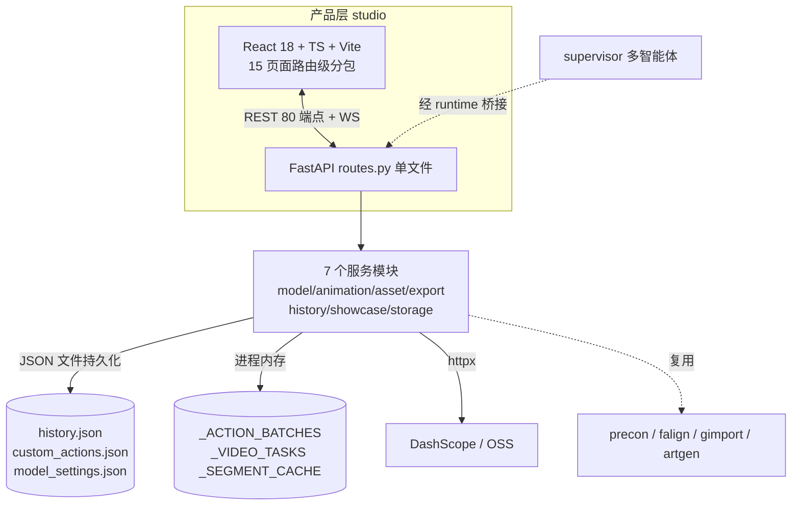
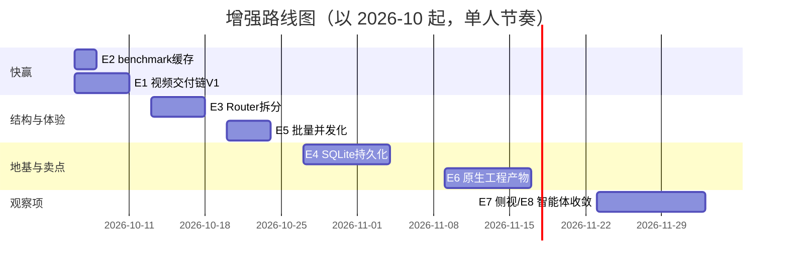

# CreativeForge 项目全景分析与增强路线图

## 一、项目总览

### 1.1 核心定位

**面向独立游戏开发者的自主规划型 AI 资产生产系统**：一句自然语言 → 多智能体规划 → 自研三引擎处理 → 可直接导入 Unity/Cocos/Godot 的游戏资产。

它不是“套壳调生成模型”，核心竞争力在三层自研技术链：

| 引擎 | 解决的问题 | 位置 |
|---|---|---|
| **PReCon** 像素重建 | AI 出图像素错位、色彩失控（37色→16色） | [precon/](file:///d:/project01/CreativeForge/precon) |
| **FAlign** 动画对齐 | 漂移/脚滑/抖动（根漂移 2.25→0.00 px/frame） | [falign/](file:///d:/project01/CreativeForge/falign) |
| **GImport** 引擎导入 | 手动拼 Prefab/切图集/配动画（100% 导入成功率） | [gimport/](file:///d:/project01/CreativeForge/gimport) |

### 1.2 目标受众

- **主用户**：独立游戏开发者/小团队（痛点量化明确：传统流程 12 步人工操作约 45 分钟/角色）；
- **次用户**：游戏 Jam 参赛者（快速出资产）、AIGC 内容创作者；
- 当前形态是**单机桌面工具**（localhost:8600，单进程前后端同体），非多租户 SaaS。

### 1.3 当前功能版图

Studio 产品层已经长成事实上的主战场，功能远超 README 的比赛叙事：

| 模块 | 功能 | 成熟度 |
|---|---|---|
| 工作台 Workspace | 自然语言→任务图→生成→资产 | ✅ E2E 16.2s 实测通过 |
| 动画工作台 | AI i2v + 程序化骨骼动画 + 自定义动作 + 批次补齐 + 历史人物 | ✅ 最重的模块（244 项回归） |
| 试玩舞台 | 键盘操控、AI 动画帧接入、165fps 实测达标 | ✅ 性能超竞品 4 倍 |
| 设计中心 | 三视图/抠图/重绘 | ✅ |
| 导出中心 | 三引擎 + 角色包 + 批量（12/12 通过） | ✅ |
| 展示间/批量生产/版本控制/历史/基准中心/存储（6 云厂商） | — | ✅ |
| 模型服务 | DashScope/多预设、Key 池、错误分类、5 层省额度缓存、用量台账 | ✅ |

**质量现状**（10-04 全系统测试）：244 动画回归 + 41 主套件 + 35 前端单测全绿；56 项 API 扫描 55 过；月度质量分 3.85（竞品 windup 4.25）；Lighthouse desktop 0.96。

---

## 二、架构分析

### 2.1 现状架构

### 2.2 架构强项（值得保持的设计决策）

1. **契约先行**：CreativeAsset schema 冻结契约，所有引擎/智能体只读写协议，边界测试固化（pages 禁 import three、裸 fetch 只许 client.ts）；
2. **测试资产化**：全量回归离线零额度可跑，测试成本记录到 0.3 元/轮——这是单人项目罕见的工程纪律；
3. **成本意识内建**：五层省额度（提示词缓存/视频缓存/Key 池/降级链/用量台账）；
4. **可观测的基线文化**：perf-baseline、quality-scores 只增不改，回归可见。

### 2.3 架构弱点（增强机会的来源）

| # | 弱点 | 证据 |
|---|---|---|
| W1 | **routes.py 单文件巨石**：80 个端点全在一个文件，估计 1700+ 行 | 新增 storage 14 端点时只能继续追加 |
| W2 | **JSON 文件 + 内存态持久化**：重启丢批次/视频任务；无事务；并发写靠原子写兜底 | `_ACTION_BATCHES`、`history.json` 52 条 |
| W3 | **单进程单用户假设**：无任务队列，批量生成与交互请求抢同一事件循环 | 批次 5×90s 串行 |
| W4 | **交付链倒挂**（已知）：720p/24fps 生成 → 384px/12fps GIF 交付，质量死在最后一公里 | video-quality-roadmap §2 已完整取证 |
| W5 | **benchmark 端点同步重算 13s**（缺陷 D-8 未修） | 测试报告 §4.3 |
| W6 | **引擎产物同文化**（缺陷 D-9）：三引擎 manifest 同文，GImport 差异化价值未完全兑现 | 同上 |
| W7 | **侧视资产浪费**：side.png 只展示不进动画管线，侧视动画靠镜像正视 | roadmap §2.3 |

---

## 三、增强机会与实施方案

按「业务价值 × 技术可行性 × 用户影响」筛出 8 项，每项给方案与收益。

### E1. 视频交付链升级 V1（快赢包）⭐ 最高优先

**问题**：W4 的零额度部分——抽帧规格与 GIF 量化是当前质量天花板的最大杀手。
**方案**（对应已有 [video-quality-roadmap](file:///d:/project01/CreativeForge/docs/video-quality-roadmap-20261003.md) V1，直接执行而非另起炉灶）：
- 抽帧 384px/12fps → 512px/24fps，抽帧窗口 1.25s→3s；
- GIF 量化改全局调色板（消除帧间色彩漂移闪烁）+ `dither=FLOYDSTEINBERG`；
- 新增 mp4 出口：复用 onetake 已验证的 ffmpeg 编码链（CRF16/faststart），GIF 降级为兼容选项。
**收益**：生成质量“免费”提升 2-4 倍信息量，零额度成本；用户第一感知即“视频不糊了”。
**工作量**：约 1 周，纯参数与编码链改动，244 项回归保护下风险低。

### E2. benchmark 结果缓存（修 D-8）

**方案**：评估报告落盘 + 10 分钟 TTL；`GET /api/benchmark` 命中缓存直接返回，`?refresh=1` 强制重算；或后台定时刷新。
**收益**：基准中心页 13s 卡顿 → <50ms；改动约 30 行，一周内随手可做。
**注**：这是测试报告明确的遗留缺陷，性价比最高的“还债”。

### E3. routes.py 按服务拆分 Router

**方案**：FastAPI `APIRouter` 按域拆为 `routers/{tasks,assets,animation,design,export,versions,storage,settings}.py`，routes.py 保留挂载；拆分纯机械搬家，现有 56 项 API 测试即验收标准。
**收益**：80 端点的单文件成为每次改动的冲突热点与认知负担；拆分后 storage/model 等模块可独立演进。建议在 E4 之前做，降低后续每次改动的爆炸半径。

### E4. 持久化升级：SQLite 替换 JSON + 内存态

**方案**：
- 第一步（不动架构）：`_ACTION_BATCHES`/`_VIDEO_TASKS` 序列化落盘，重启恢复运行中批次——解决“生成到一半重启全丢”；
- 第二步：history/custom_actions/versions 迁 SQLite（SQLAlchemy 2.0，你技术栈已有），保留 JSON 导入迁移脚本；原子写与文件锁问题一并消失。
**收益**：稳定性维度（月度评分 3.0，落后竞品 1 分）的最大失分点；为 E5 多任务并发打地基。
**注意**：与你的技术栈偏好一致（SQLAlchemy 在列），但**不建议**一步到 PostgreSQL——单机工具 SQLite 足够，避免引入部署依赖。

### E5. 批量生成并发化

**方案**：批次从串行 5×90s 改为 `asyncio.Semaphore(2)` 有界并发（视频生成是 IO 等待，并发 2 路即可近 2 倍吞吐）；配合 E4 的持久化做断点续跑。
**收益**：一键补齐动作等待时间减半——这是动画工作台最高频等待场景，直接的用户体验提升。
**前提**：先确认 DashScope 并发配额，Key 池轮换逻辑已就位可分摊限流风险。

### E6. GImport 原生工程产物（修 D-9）

**方案**：Unity 适配器产出 `.unitypackage`（本质是 tar.gz + meta 文件，格式公开）；Godot 产出 `.tscn`+资源目录；Cocos 产出 scene json。manifest 保留为通用层，原生层叠加。
**收益**：把“一键导入”从 JSON 清单兑现为真正的双击可用——**核心卖点闭环**，演示价值与用户价值同时提升；工作量集中且边界清晰（gimport/adapters 已有适配器接口）。

### E7. 侧视动画管线

**方案**：side.png 进入动画条件图候选；i2v 按视角路由 source 图；程序化链用侧视骨架参数替代镜像。
**收益**：消灭“侧视=镜像”的出戏感；素材端零新增成本（三视图已在生成），是纯管线接线工作。

### E8. 智能体层与 Studio 层的功能收敛

**问题**：`agents/`（比赛叙事的多智能体）与 `studio/backend`（实际产品）存在双轨：Studio 只经 `agent_runtime/runtime.py` 桥接了规划能力，QA 修复轮、检查点恢复、Memory Agent 的能力未进入产品主流程。
**方案**：把 QA Agent 的质量门 + 修复轮接入动画批次收尾（生成后自动 rig-check + 低分重试一次）；任务图事件流接入批量生产中心。
**收益**：让 README 的“自主规划+QA 修复”叙事成为真实用户可感知的功能，而非演示代码；同时提升生成资产的一次通过率（省额度）。

---

## 四、优先级矩阵

| 编号 | 增强项 | 业务价值 | 可行性 | 用户影响 | 综合 | 建议批次 |
|---|---|---|---|---|---|---|
| E2 | benchmark 缓存 | 中 | 高（30 行） | 高（去 13s 卡顿） | 🥇 | 立即 |
| E1 | 视频交付链 V1 | 高 | 高（零额度） | 高（质量翻倍感知） | 🥇 | 第 1 周 |
| E3 | Router 拆分 | 中 | 高（机械） | 中（开发效率） | 🥈 | 第 2 周 |
| E5 | 批量并发化 | 中高 | 中高 | 高（等待减半） | 🥈 | 第 3 周 |
| E4 | SQLite 持久化 | 高 | 中 | 中高（稳定性） | 🥉 | 第 4-5 周 |
| E6 | 原生工程产物 | 高 | 中 | 高（卖点闭环） | 🥉 | 第 6-7 周 |
| E7 | 侧视管线 | 中 | 中高 | 中 | 观察项 | 按需 |
| E8 | 智能体收敛 | 中高 | 中低 | 中 | 观察项 | V2 |

（E7/E8 价值真实但依赖前序项稳固，放观察队列防止战线过长。）

---

## 五、实施路线图

**每批次的验收锚点**（复用你已有的基线体系）：

1. **快赢批**：视频 A/B 对比（i2v_bench.py 现成）；benchmark 端点 <100ms；244 项回归全绿；
2. **结构批**：56 项 API 扫描零回归；批次端到端时间 ≤ 原来 60%；
3. **地基批**：重启后批次/视频任务可恢复；月度质量分“稳定性”从 3.0 → 3.5+；
4. **卖点批**：Unity 双击导入 `.unitypackage` 成功；导出专项 12 用例扩到含原生产物断言。

---

## 六、一句话总结

**项目已完成“从 0 到 1”（功能全、质量门全、测试全），“从 1 到 1.5”的最大杠杆不在加新功能，而在三件事：把死在交付链的视频质量救回来（E1）、把已知欠账还掉（E2/E3）、把核心卖点从 JSON 清单兑现为真正的引擎工程包（E6）。**
